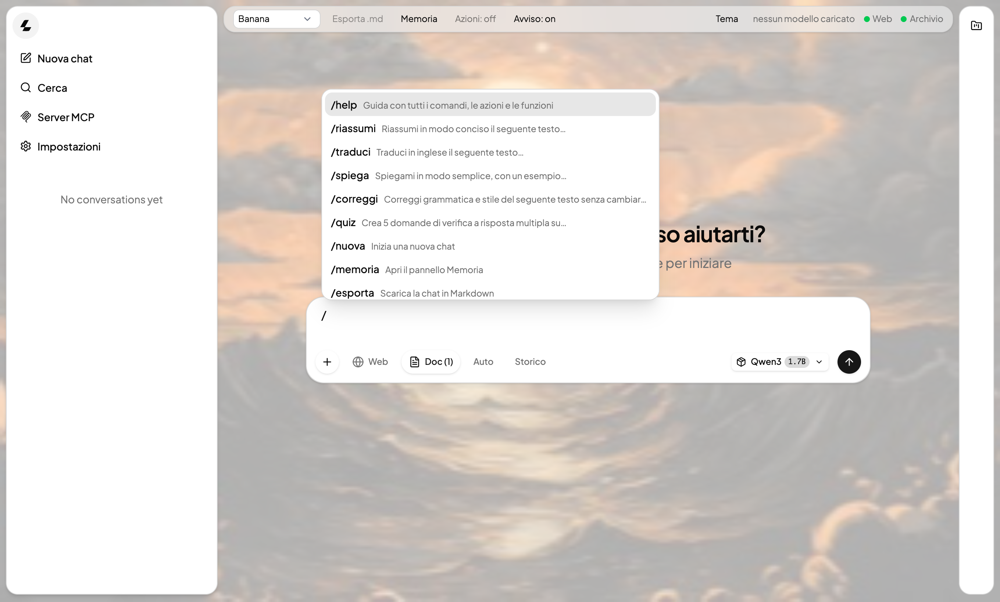
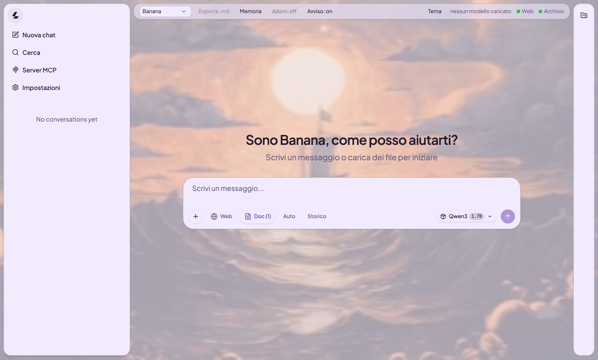
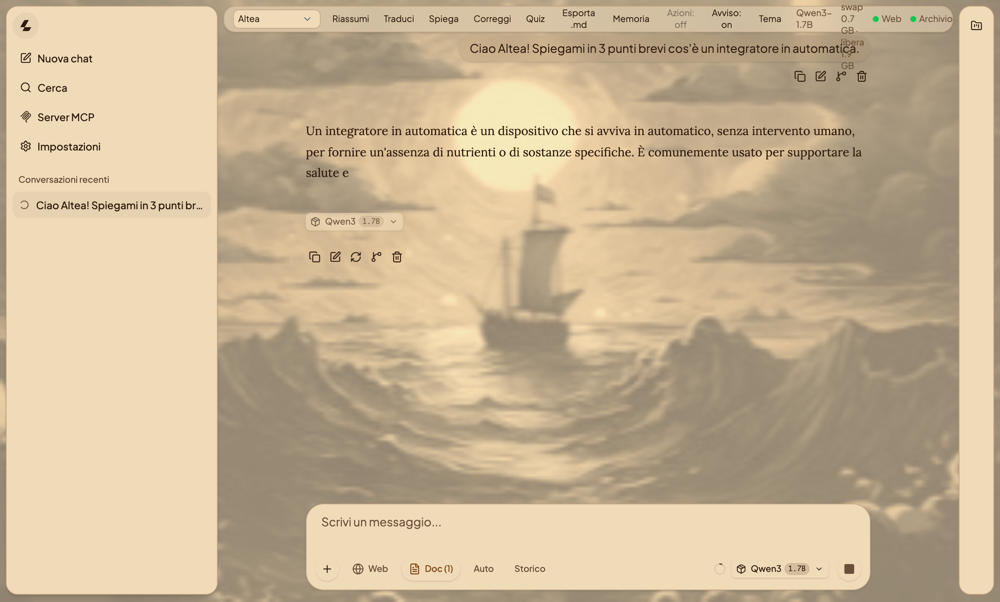
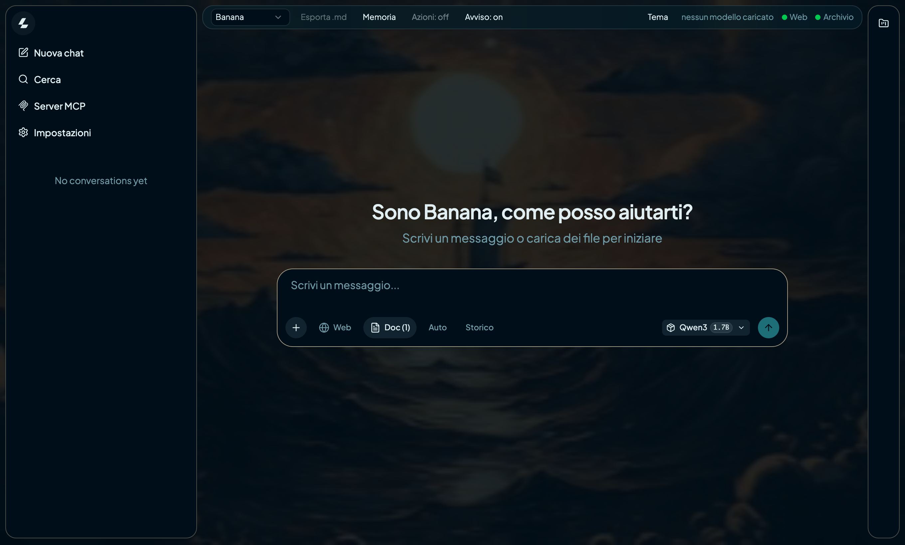
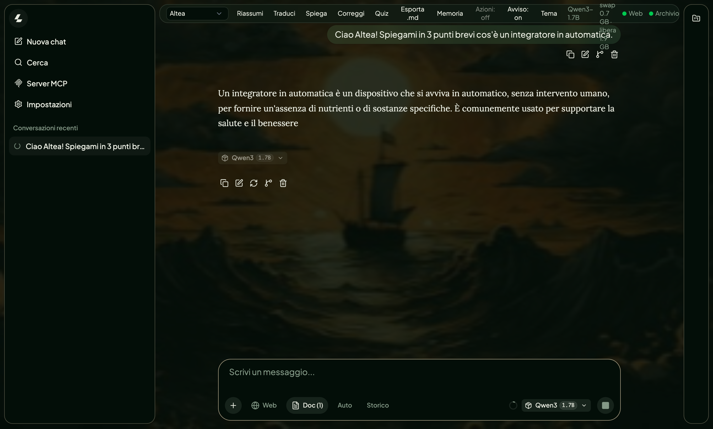
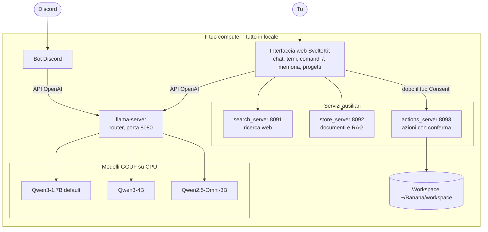

<p align="center"></p>

# Banana (llm-cpp)

Banana è un'IA locale in C++ che gira interamente sul tuo computer: chat da terminale e interfaccia web in italiano, basate su [llama.cpp](https://github.com/ggml-org/llama.cpp) e modelli Qwen in formato GGUF. Sviluppata e testata su Mac Intel, 8 GB di RAM, solo CPU.

   

[](https://github.com/mistery-alex06/llm-cpp/wiki)

> ## 📖 La documentazione completa è nella [Wiki](https://github.com/mistery-alex06/llm-cpp/wiki)
> Installazione, avvio su macOS e Windows, tutte le funzioni, comandi, temi, azioni sul computer, bot Discord e roadmap. Qui sotto trovi solo l'essenziale.
>
> **[Apri la Wiki →](https://github.com/mistery-alex06/llm-cpp/wiki)**

## In breve

- Risponde in locale, in italiano e al femminile; tre modelli (Qwen3-1.7B, Qwen3-4B, Qwen2.5-Omni-3B).
- Ricerca web opzionale, documenti locali (RAG), memoria persistente, progetti, immagini, audio e video.
- Interfaccia web con temi, comandi `/` (scrivi `/help`), azioni sul computer con conferma, bot Discord.
- Avvio con un clic su macOS (`Banana.app`) e Windows (`Banana.bat`).

## Anteprima


| Menu dei comandi `/` | Tema Lavanda | Tema Seppia |
|---|---|---|
|  |  |  |

| Tema Oceano | Tema Foresta |
|---|---|
|  |  |

## Come è fatta



Approfondimenti: [Come funziona](https://github.com/mistery-alex06/llm-cpp/wiki/Come-funziona) · [Interfaccia](https://github.com/mistery-alex06/llm-cpp/wiki/Interfaccia) · [Azioni sul computer](https://github.com/mistery-alex06/llm-cpp/wiki/Azioni-sul-computer) · [Discord](https://github.com/mistery-alex06/llm-cpp/wiki/Discord) · [Modelli e prestazioni](https://github.com/mistery-alex06/llm-cpp/wiki/Modelli-e-prestazioni)

## Avvio rapido

```bash
# 1. compila llama.cpp (motore, server e UI web)
cd llama.cpp && cmake -B build -DCMAKE_BUILD_TYPE=Release -DLLAMA_BUILD_UI=ON
cmake --build build --config Release -j4 && cd ..

# 2. scarica almeno un modello .gguf nella cartella llm/ (vedi Installazione nella wiki)

# 3. avvia il server e apri http://127.0.0.1:8080
./run_qwen_server.sh
```

## 📖 Documentazione nella [Wiki](https://github.com/mistery-alex06/llm-cpp/wiki)

| Pagina | Contenuto |
|---|---|
| [Installazione](https://github.com/mistery-alex06/llm-cpp/wiki/Installazione) | requisiti, compilazione, modelli |
| [Avvio](https://github.com/mistery-alex06/llm-cpp/wiki/Avvio) | macOS, Windows, terminale |
| [Uso di Banana](https://github.com/mistery-alex06/llm-cpp/wiki/Uso-di-Banana) | memoria, ricerca web, documenti, video, backup |
| [Interfaccia](https://github.com/mistery-alex06/llm-cpp/wiki/Interfaccia) | barra superiore, progetti, comandi, temi |
| [Azioni sul computer](https://github.com/mistery-alex06/llm-cpp/wiki/Azioni-sul-computer) | azioni con conferma e sicurezza |
| [Discord](https://github.com/mistery-alex06/llm-cpp/wiki/Discord) | bot Discord |
| [Modelli e prestazioni](https://github.com/mistery-alex06/llm-cpp/wiki/Modelli-e-prestazioni) | scelta del modello e parametri |
| [Sviluppo](https://github.com/mistery-alex06/llm-cpp/wiki/Sviluppo) | personalizzazione, struttura, roadmap |
